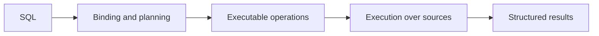

<!-- Hallmark · pre-emit critique: P4 H4 E4 S5 R4 V4 -->

# Musoq

**Musoq — an investigation runtime that uses SQL.**

Compose data, relate records, and describe text and binary formats in the same query language. Musoq performs the data operations and returns structured results that people and agents can inspect.

[](https://opensource.org/licenses/MIT)
[](https://github.com/Puchaczov/Musoq/graphs/code-frequency)
[](https://www.nuget.org/packages?q=musoq)


The fifteen examples below show the language's building blocks with complete queries and inline inputs. Their [runnable files and expected results](docs/examples/readme/README.md) include provenance and prerequisites.

[Compose data](#define-and-compose-data) · [Relate records](#relate-and-expand-records) · [Aggregate and select](#aggregate-and-select-results) · [Recurse](#recurse) · [Input formats](#declare-input-formats) · [Source contracts](#bind-source-contracts)

## Define and compose data

### Inline VALUES and expressions

Create a small relation, compute a projection, and filter its rows.

```sql
select s.Name as Name, s.Price * s.Quantity as Total
from values {
    (Name: 'A', Price: 12, Quantity: 2),
    (Name: 'B', Price: 8, Quantity: 1)
} s
where s.Price >= 10
order by Name
```

**Result:** `A` has `Total = 24`.

[Language reference](specs/musoq-core-language-spec.md#65-inline-values-row-sources).

### Parameters and local variables

Declare typed runtime parameters and reusable local values, then reference them with `$`.

```sql
param(minScore: int = 20)
let category: string = 'Books'

select s.Name as Name
from values {
    (Category: 'Books', Name: 'A', Score: 30),
    (Category: 'Books', Name: 'B', Score: 10)
} s
where s.Category = $category and s.Score >= $minScore
order by Name
```

**Result with defaults:** `A`. Parameter overrides are documented in the [example companion](docs/examples/readme/README.md#parameters-and-local-variables).

[Language reference](specs/musoq-core-language-spec.md#43-script-parameters).

### CTE composition

Name an intermediate result and query it in another stage.

```sql
with totals as (
    select s.Name as Name, Sum(s.Amount) as Total
    from values {
        (Name: 'A', Amount: 10),
        (Name: 'A', Amount: 15),
        (Name: 'B', Amount: 5)
    } s
    group by s.Name
)
select Name, Total
from totals
where Total >= 20
order by Name
```

**Result:** `A` has `Total = 25`.

[Language reference](specs/musoq-core-language-spec.md#14-common-table-expressions-ctes).

## Relate and expand records

### LEFT JOIN

Keep left-side records even when the right side has no match.

```sql
select a.Name as Name, b.Score as Score
from values { (Id: 1, Name: 'A'), (Id: 2, Name: 'B') } a
left join values { (Id: 1, Score: 30) } b on a.Id = b.Id
order by Name
```

| Name | Score |
|---|---:|
| A | 30 |
| B | NULL |

[Language reference](specs/musoq-core-language-spec.md#82-left-outer-join).

### ANTI JOIN

Select left-side records for which no right-side match exists.

```sql
select a.Name as Name
from values { (Id: 1, Name: 'A'), (Id: 2, Name: 'B') } a
anti join values { (Id: 1) } b on a.Id = b.Id
order by Name
```

**Result:** `B`.

[Language reference](specs/musoq-core-language-spec.md#86-anti-join).

### ASOF matching

Select the nearest preceding timestamp within an equality partition.

```sql
with errors as (
    select e.Service as Service, e.At::datetime as ErrorTime
    from values {
        (Service: 'checkout', At: '2026-10-11T10:05:00'),
        (Service: 'checkout', At: '2026-10-11T10:20:00')
    } e
), deployments as (
    select
        d.Service as Service,
        d.At::datetime as DeployedAt,
        d.Version as Version
    from values {
        (Service: 'checkout', At: '2026-10-11T10:00:00', Version: 'v1'),
        (Service: 'checkout', At: '2026-10-11T10:15:00', Version: 'v2')
    } d
)
select e.ErrorTime as ErrorTime, d.Version as Version
from errors e
asof join deployments d
    on e.Service = d.Service and e.ErrorTime >= d.DeployedAt
order by e.ErrorTime
```

| ErrorTime | Version |
|---|---|
| 2026-10-11T10:05:00 | v1 |
| 2026-10-11T10:20:00 | v2 |

[Language reference](specs/musoq-core-language-spec.md#811-asof-join).

### CROSS APPLY over collections

Expand a collection into rows alongside its parent record.

```sql
with source as (
    select s.Name as Name, array { 1, 2 } as Items
    from values { (Name: 'A') } s
)
select s.Name as Name, item.Value as Value
from source s
cross apply s.Items item
order by Value
```

**Result:** `(A, 1)` and `(A, 2)`.

[Language reference](specs/musoq-core-language-spec.md#9-apply-clause).

## Aggregate and select results

### Conditional aggregates

Use FILTER to restrict one aggregate while another counts the whole group.

```sql
select
    s.Component as Component,
    Count(*) as Total,
    Count(*) filter (where s.Level = 'ERROR') as Errors
from values {
    (Component: 'api', Level: 'INFO'),
    (Component: 'api', Level: 'ERROR'),
    (Component: 'worker', Level: 'INFO')
} s
group by s.Component
order by Component
```

| Component | Total | Errors |
|---|---:|---:|
| api | 2 | 1 |
| worker | 1 | 0 |

[Language reference](specs/musoq-core-language-spec.md#10-group-by-and-aggregation).

### Window ranking and QUALIFY

Rank within a partition, then filter window results in the same query block.

```sql
select
    s.Category as Category,
    s.Name as Name,
    s.Score as Score,
    RowNumber() over (
        partition by s.Category
        order by s.Score desc, s.Name
    ) as Position
from values {
    (Category: 'Books', Name: 'A', Score: 30),
    (Category: 'Books', Name: 'B', Score: 10),
    (Category: 'Games', Name: 'C', Score: 20),
    (Category: 'Games', Name: 'D', Score: 15)
} s
qualify Position = 1
order by Category
```

| Category | Name | Score | Position |
|---|---|---:|---:|
| Books | A | 30 | 1 |
| Games | C | 20 | 1 |

[Language reference](specs/musoq-core-language-spec.md#1113-qualify-clause).

### UNION ALL

Combine relations while retaining duplicate rows.

```sql
with combined as (
    select a.Value as Value
    from values { (Value: 1), (Value: 2) } a
    union all
    select b.Value as Value
    from values { (Value: 2), (Value: 3) } b
)
select Value
from combined
order by Value
```

**Result:** `1, 2, 2, 3`.

[Language reference](specs/musoq-core-language-spec.md#12-set-operations).

## Recurse

### Recursive CTEs and keyed UNION

Carry state across recursive generations, using selected columns as identity.

```sql
with recursive edges as (
    select e.Service as Service, e.Dependency as Dependency
    from values {
        (Service: 'checkout', Dependency: 'payments'),
        (Service: 'payments', Dependency: 'ledger'),
        (Service: 'ledger', Dependency: 'checkout')
    } e
), dependencies (Service, Depth) as (
    select 'checkout', 0 from values { (Seed: 1) } seed
    union (Service)
    select e.Dependency, d.Depth + 1
    from dependencies d
    inner join edges e on d.Service = e.Service
)
select Service, Depth
from dependencies
order by Depth
```

| Service | Depth |
|---|---:|
| checkout | 0 |
| payments | 1 |
| ledger | 2 |

[Language reference](specs/musoq-core-language-spec.md#149-recursive-ctes-and-limitations).

Depth 0 is the starting service. The edge back to checkout adds no new identity, so the cycle terminates.

## Declare input formats

### Inline text formats

Describe the input format beside the query; its fields become available to the rest of the SQL.

```sql
text Entry {
    Level: token,
    _: whitespace,
    Message: rest
};

select e.Level as Level, e.Message as Message
from values {
    (Line: 'INFO ready'),
    (Line: 'ERROR retry failed')
} s
cross apply Parse<Entry>(s.Line) e
order by Level
```

| Level | Message |
|---|---|
| ERROR | retry failed |
| INFO | ready |

[Language reference](specs/musoq-binary-text-spec.md#5-text-schema-syntax).

### Tolerant text handling

Combine TryParse with OUTER APPLY to keep rejected records in the result.

```sql
text Entry {
    Prefix: literal 'OK:',
    Message: rest
};

select s.Id as Id, p.Message as Message
from values {
    (Id: 1, Line: 'OK:ready'),
    (Id: 2, Line: 'bad')
} s
outer apply TryParse<Entry>(s.Line) p
order by s.Id
```

**Result:** `(1, ready)` and `(2, NULL)`.

[Language reference](specs/musoq-binary-text-spec.md#75-safe-interpretation).

### Inline binary formats

Declare field widths and a length-dependent payload, then select the interpreted fields.

```sql
binary Header {
    Kind: byte,
    Size: short le,
    Payload: byte[Size]
};

with input as (
    select FromHexToBytes('010300AABBCC') as Data
    from system.dual()
)
select
    h.Kind as Kind,
    h.Size as Size,
    Length(h.Payload) as PayloadBytes
from input i
cross apply Interpret<Header>(i.Data) h
```

**Result:** `Kind = 1`, `Size = 3`, `PayloadBytes = 3`. Requires the **System provider**.

[Language reference](specs/musoq-binary-text-spec.md#4-binary-schema-syntax).

[Tagged payloads and the default-branch fixture](docs/examples/readme/README.md#supplemental-binary-default-branch) provide an additional format variation.

## Bind source contracts

### TABLE and COUPLE

Bind a declared row contract to a source method under a query-local alias.

```sql
table Seed {
    Dummy: string
};

couple system.dual with table Seed as Seeds;

select s.Dummy as Dummy
from Seeds() s
```

**Result:** `Dummy = X`. Requires the **System provider**; `Dummy: string` is the observed `system.dual()` source contract.

[Language reference](specs/musoq-table-couple-spec.md).

## Advanced: how a query executes



Binding resolves fields, types, and functions. Planning selects how relationships and data operations execute. Executable operations then run over source records and produce structured results. Providers supply records and metadata; the runtime combines and shapes them.

See the [architecture reference](.claude/rules/architecture.md) for the current planning and execution pipeline.

## Language references and further documentation

- [Core SQL language](specs/musoq-core-language-spec.md): syntax, relational behavior, functions, and diagnostics.
- [Text and binary interpretation](specs/musoq-binary-text-spec.md): format declarations and interpretation functions.
- [TABLE and COUPLE](specs/musoq-table-couple-spec.md): source contracts and query-local bindings.
- [Runnable syntax examples](docs/examples/readme/README.md): prerequisites, provenance, execution commands, and expected results.
- [Engine development guide](.github/copilot-instructions.md): implementation and contribution guidance.

Diagnostic-aware compilation reports intent mistakes, including null-sensitive predicates such as `where Name not in ('Alice', NULL)` and impossible implicit conversions (`MQ5025`). See the [diagnostic contract and catalog](specs/musoq-core-language-spec.md#23-diagnostic-contract-and-catalog).

## License

Musoq is licensed under the [MIT License](LICENSE), permitting commercial and non-commercial use.
