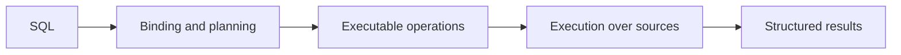

<!-- Hallmark · pre-emit critique: P5 H4 E4 S5 R4 V4 -->

# Musoq

**Musoq — an investigation runtime that uses SQL.**

Search code, inspect logs, follow dependencies, and decode binary records. Combine these steps in SQL to explore your data and return structured results you can inspect.

[](https://opensource.org/licenses/MIT)
[](https://github.com/Puchaczov/Musoq/graphs/code-frequency)
[](https://www.nuget.org/packages?q=musoq)


### Find source files · Search

List five C# files from this repository, ordered by path.

```sql
param(root: string = './src/dotnet/Musoq.Parser')

select p.Path as Path
from search.paths($root, options: (scope: (
    include: array { '*.cs', '**/*.cs' },
    exclude: array { '**/obj/**', '**/bin/**' }
))) p
order by p.Path
take 5
```

**Result for this checkout:**

| Path |
|---|
| BinarySchemaParser.FieldValidation.cs |
| BinarySchemaParser.FieldValidationLiterals.cs |
| BinarySchemaParser.Schema.cs |
| BinarySchemaParser.SizedTypes.cs |
| BinarySchemaParser.Validation.cs |

Pass your input directory as `$root`; the [companion](docs/examples/readme/README.md#running-search-queries) shows absolute-root execution commands. Paths are relative to the selected source directory.

Requires the **Search provider**.

A datasource provider makes a source available as rows and columns that your query can use.

These 28 examples have [runnable files, inputs, prerequisites, and expected results](docs/examples/readme/README.md). Run file-based examples from the repository root; inline examples include their own data.

[Query files](#query-files) · [Select and calculate](#select-and-calculate) · [Group and rank](#group-and-rank) · [Combine data](#combine-data) · [Reuse queries](#reuse-queries-and-follow-links) · [Input formats](#input-formats-and-source-contracts)

## Query files

Search exposes file paths, lines, and matches as rows; SQL filters and combines those rows. These four queries read the [same six sample log records](docs/examples/readme/README.md#search-inputs).

### Find matching lines · Search

Search the [sample logs](docs/examples/readme/README.md#search-inputs) and keep the matching line beside its location.

```sql
param(root: string = './docs/examples/readme/fixtures')

select s.Path as Path, s.LineNumber as Line, s.LineText as Text
from search.lines($root, 'ERROR',
    options: (scope: (include: array { '*.log' }))) s
order by s.Path, s.LineNumber
```

**Result:**

| Path | Line | Text |
|---|---|---|
| app.log | 2 | ERROR service=checkout code=E42 message=retry failed |
| app.log | 3 | ERROR service=checkout code=E42 message=timeout |
| worker.log | 2 | ERROR service=payments code=E17 message=payment failed |

LineText includes each line's ending; the table omits it, while the companion records exact JSON.

Requires the **Search provider**.

### Count labeled matches · Search and GROUP BY

Search for several patterns and count each label separately.

```sql
param(root: string = './docs/examples/readme/fixtures')

select m.PatternId as Level, Count(*) as Occurrences
from search.many($root, patterns: array {
    (id: 'ERROR', pattern: 'ERROR'),
    (id: 'WARN', pattern: 'WARN')
}, options: (scope: (include: array { '*.log' }))) m
group by m.PatternId
order by Level
```

**Result:**

| Level | Occurrences |
|---|---|
| ERROR | 3 |
| WARN | 1 |

Requires the **Search provider**.

### Find files containing both patterns · CTE and HAVING

Count distinct pattern labels so repeated errors alone cannot qualify a file.

```sql
param(root: string = './docs/examples/readme/fixtures')

with topics as (
    select m.Path as Path, m.PatternId as Level
    from search.many($root, patterns: array {
        (id: 'ERROR', pattern: 'ERROR'),
        (id: 'WARN', pattern: 'WARN')
    }, options: (scope: (include: array { '*.log' }))) m
    group by m.Path, m.PatternId
)
select t.Path as Path, Count(*) as Levels
from topics t
group by t.Path
having Count(*) = 2
order by Path
```

**Result:** `Path = worker.log`, `Levels = 2`.

Requires the **Search provider**.

### Extract values from matches · Captures and APPLY

Turn named regex captures into rows, then count records by service.

```sql
param(root: string = './docs/examples/readme/fixtures')

select c.Text as Service, Count(*) as Records
from search.matches($root,
    'service=(?<service>[a-z]+)', options: (
        text: (mode: 'regex'),
        records: (mode: 'physical-line', maxBytes: 1048576),
        scope: (include: array { '*.log' })
    )) m
cross apply m.Captures c
where c.GroupName = 'service' and c.Success = true
group by c.Text
order by Service
```

**Result:**

| Service | Records |
|---|---|
| auth | 1 |
| checkout | 3 |
| payments | 2 |

Requires the **Search provider**.

[Search provider reference](https://github.com/Puchaczov/Musoq.DataSources/tree/master/Musoq.DataSources.Search) · [Grouping and HAVING](specs/musoq-core-language-spec.md#10-group-by-and-aggregation).

## Select and calculate

Start with rows, choose the fields you need, and express conditions.

### Create rows and calculate values · VALUES

Create a small input, calculate a total, and filter its rows.

```sql
select s.Name as Name, s.Price * s.Quantity as Total
from values {
    (Name: 'A', Price: 12, Quantity: 2),
    (Name: 'B', Price: 8, Quantity: 1)
} s
where s.Price >= 10
order by Name
```

**Result:** `Name = A`, `Total = 24`.

### Match names and allowed values · LIKE and IN

Combine a filename pattern with a list of allowed values.

```sql
select s.Name as Name
from values {
    (Name: 'api.cs', Kind: 'source'),
    (Name: 'app.cs', Kind: 'source'),
    (Name: 'notes.txt', Kind: 'document')
} s
where s.Name like 'a%.cs' and s.Kind in ('source', 'test')
order by Name
```

**Result:**

| Name |
|---|
| api.cs |
| app.cs |

### Choose values conditionally · CASE

Assign a label according to each row's score.

```sql
select
    s.Name as Name,
    case when s.Score >= 20 then 'high' else 'low' end as Band
from values {
    (Name: 'Ada', Score: 30),
    (Name: 'Ben', Score: 10)
} s
order by Name
```

**Result:**

| Name | Band |
|---|---|
| Ada | high |
| Ben | low |

### Keep rows with a matching record · EXISTS

Select customers for whom at least one matching order exists.

```sql
select c.Name as Name
from values { (Id: 1, Name: 'Ada'), (Id: 2, Name: 'Ben') } c
where exists (
    select 1
    from values { (CustomerId: 1) } o
    where o.CustomerId = c.Id
)
order by Name
```

**Result:** `Name = Ada`.

[Expressions](specs/musoq-core-language-spec.md#5-select-clause) · [Filtering](specs/musoq-core-language-spec.md#7-where-clause).

## Group and rank

Summarize rows or select the strongest result in each group.

### Filter group totals · HAVING

Sum amounts by team, then keep groups whose total reaches 20.

```sql
select s.Team as Team, Sum(s.Amount) as Total
from values {
    (Team: 'api', Amount: 10),
    (Team: 'api', Amount: 15),
    (Team: 'worker', Amount: 5)
} s
group by s.Team
having Sum(s.Amount) >= 20
order by Team
```

**Result:** `Team = api`, `Total = 25`.

### Count selected rows · FILTER

Count every row in a group and ERROR rows in the same query.

```sql
select
    s.Component as Component,
    Count(*) as Total,
    Count(*) filter (where s.Level = 'ERROR') as Errors
from values {
    (Component: 'api', Level: 'INFO'),
    (Component: 'api', Level: 'ERROR'),
    (Component: 'worker', Level: 'INFO')
} s
group by s.Component
order by Component
```

**Result:**

| Component | Total | Errors |
|---|---|---|
| api | 2 | 1 |
| worker | 1 | 0 |

### Pick the highest score per category · Windows and QUALIFY

Rank rows within each category, then keep its first-ranked row.

```sql
select
    s.Category as Category,
    s.Name as Name,
    s.Score as Score,
    RowNumber() over (
        partition by s.Category
        order by s.Score desc, s.Name
    ) as Position
from values {
    (Category: 'Books', Name: 'A', Score: 30),
    (Category: 'Books', Name: 'B', Score: 10),
    (Category: 'Games', Name: 'C', Score: 20),
    (Category: 'Games', Name: 'D', Score: 15)
} s
qualify Position = 1
order by Category
```

**Result:**

| Category | Name | Score | Position |
|---|---|---|---|
| Books | A | 30 | 1 |
| Games | C | 20 | 1 |

[Aggregation](specs/musoq-core-language-spec.md#10-group-by-and-aggregation) · [Window results and QUALIFY](specs/musoq-core-language-spec.md#1113-qualify-clause).

## Combine data

Match records, expand collections, or append results.

### Keep unmatched rows · LEFT JOIN

Keep left-side records even when the right side has no match.

```sql
select a.Name as Name, b.Score as Score
from values { (Id: 1, Name: 'A'), (Id: 2, Name: 'B') } a
left join values { (Id: 1, Score: 30) } b on a.Id = b.Id
order by Name
```

**Result:**

| Name | Score |
|---|---|
| A | 30 |
| B | NULL |

### Find rows without a match · ANTI JOIN

Select left-side records for which no right-side match exists.

```sql
select a.Name as Name
from values { (Id: 1, Name: 'A'), (Id: 2, Name: 'B') } a
anti join values { (Id: 1) } b on a.Id = b.Id
order by Name
```

**Result:** `Name = B`.

### Match the nearest earlier time · ASOF

Match each error to the nearest preceding deployment for the same service.

```sql
with errors as (
    select e.Service as Service, e.At::datetime as ErrorTime
    from values {
        (Service: 'checkout', At: '2026-10-11T10:05:00'),
        (Service: 'checkout', At: '2026-10-11T10:20:00')
    } e
), deployments as (
    select
        d.Service as Service,
        d.At::datetime as DeployedAt,
        d.Version as Version
    from values {
        (Service: 'checkout', At: '2026-10-11T10:00:00', Version: 'v1'),
        (Service: 'checkout', At: '2026-10-11T10:15:00', Version: 'v2')
    } d
)
select e.ErrorTime as ErrorTime, d.Version as Version
from errors e
asof join deployments d
    on e.Service = d.Service and e.ErrorTime >= d.DeployedAt
order by e.ErrorTime
```

**Result:**

| ErrorTime | Version |
|---|---|
| 2026-10-11T10:05:00 | v1 |
| 2026-10-11T10:20:00 | v2 |

This establishes temporal association, not causation.

### Expand a collection · CROSS APPLY

Turn collection items into rows alongside their parent record.

```sql
with source as (
    select s.Name as Name, array { 1, 2 } as Items
    from values { (Name: 'A') } s
)
select s.Name as Name, item.Value as Value
from source s
cross apply s.Items item
order by Value
```

**Result:**

| Name | Value |
|---|---|
| A | 1 |
| A | 2 |

### Combine results and keep duplicates · UNION ALL

Append one result to another without removing duplicate rows.

```sql
with combined as (
    select a.Value as Value
    from values { (Value: 1), (Value: 2) } a
    union all
    select b.Value as Value
    from values { (Value: 2), (Value: 3) } b
)
select Value
from combined
order by Value
```

**Result:** 1, 2, 2, 3.

[Joins](specs/musoq-core-language-spec.md#8-join-clause) · [APPLY](specs/musoq-core-language-spec.md#9-apply-clause) · [Set operations](specs/musoq-core-language-spec.md#12-set-operations).

## Reuse queries and follow links

Name values and intermediate results, or follow relationships repeatedly.

### Reuse input values · Parameters and variables

Declare a default input and a local value, then reference them with `$`.

```sql
param(minScore: int = 20)
let category: string = 'Books'

select s.Name as Name
from values {
    (Category: 'Books', Name: 'A', Score: 30),
    (Category: 'Books', Name: 'B', Score: 10)
} s
where s.Category = $category and s.Score >= $minScore
order by Name
```

**Result:** `Name = A`.

See [parameter overrides](docs/examples/readme/README.md#parameters-and-local-variables).

### Name an intermediate result · CTE

Give a calculated result a name and query it in another stage.

```sql
with totals as (
    select s.Name as Name, Sum(s.Amount) as Total
    from values {
        (Name: 'A', Amount: 10),
        (Name: 'A', Amount: 15),
        (Name: 'B', Amount: 5)
    } s
    group by s.Name
)
select Name, Total
from totals
where Total >= 20
order by Name
```

**Result:** `Name = A`, `Total = 25`.

### Follow repeated links · Recursive CTE

Follow dependency links while using Service as the identity of each admitted row.

```sql
with recursive edges as (
    select e.Service as Service, e.Dependency as Dependency
    from values {
        (Service: 'checkout', Dependency: 'payments'),
        (Service: 'payments', Dependency: 'ledger'),
        (Service: 'ledger', Dependency: 'checkout')
    } e
), dependencies (Service, Depth) as (
    select 'checkout', 0 from values { (Seed: 1) } seed
    union (Service)
    select e.Dependency, d.Depth + 1
    from dependencies d
    inner join edges e on d.Service = e.Service
)
select Service, Depth
from dependencies
order by Depth
```

**Result:**

| Service | Depth |
|---|---|
| checkout | 0 |
| payments | 1 |
| ledger | 2 |

Depth 0 is the starting service. The edge back to checkout adds no new identity, so the cycle terminates.

[Script parameters](specs/musoq-core-language-spec.md#43-script-parameters) · [CTEs and recursion](specs/musoq-core-language-spec.md#14-common-table-expressions-ctes).

## Input formats and source contracts

Describe a text or binary format beside the query, then use its fields in SQL.

### Describe text fields · Inline text formats

Describe the input format beside the query; its fields become available to the rest of the SQL.

```sql
text Entry {
    Level: token,
    _: whitespace,
    Message: rest
};

select e.Level as Level, e.Message as Message
from values {
    (Line: 'INFO ready'),
    (Line: 'ERROR retry failed')
} s
cross apply Parse<Entry>(s.Line) e
order by Level
```

**Result:**

| Level | Message |
|---|---|
| ERROR | retry failed |
| INFO | ready |

### Keep malformed text rows · TryParse

Combine TryParse with OUTER APPLY to retain rejected input rows.

```sql
text Entry {
    Prefix: literal 'OK:',
    Message: rest
};

select s.Id as Id, p.Message as Message
from values {
    (Id: 1, Line: 'OK:ready'),
    (Id: 2, Line: 'bad')
} s
outer apply TryParse<Entry>(s.Line) p
order by s.Id
```

**Result:**

| Id | Message |
|---|---|
| 1 | ready |
| 2 | NULL |

[Detailed semantics](specs/musoq-binary-text-spec.md#75-safe-interpretation).

### Describe binary fields · Inline binary formats

Declare field widths and a length-dependent payload, then select the interpreted fields.

```sql
binary Header {
    Kind: byte,
    Size: short le,
    Payload: byte[Size]
};

with input as (
    select FromHexToBytes('010300AABBCC') as Data
    from system.dual()
)
select
    h.Kind as Kind,
    h.Size as Size,
    Length(h.Payload) as PayloadBytes
from input i
cross apply Interpret<Header>(i.Data) h
```

**Result:** `Kind = 1`, `Size = 3`, `PayloadBytes = 3`.

Requires the **System provider**.

### Read a record inside a record · Nested binary formats

Name a reusable record format and select a field from its nested value.

```sql
binary User {
    UserId: int le
};

binary Packet {
    Kind: byte,
    User: User
};

with input as (
    select FromHexToBytes('012A000000') as Data
    from system.dual()
)
select p.Kind as Kind, p.User.UserId as UserId
from input i
cross apply Interpret<Packet>(i.Data) p
```

**Result:** `Kind = 1`, `UserId = 42`.

Requires the **System provider**.

[Detailed semantics](specs/musoq-binary-text-spec.md#43-nested-schemas).

### Read repeated values · Binary arrays

Use a count field to read an array, then expand its items into rows.

```sql
binary Batch {
    Count: byte,
    Items: short le[Count]
};

with input as (
    select FromHexToBytes('0207002A00') as Data
    from system.dual()
)
select item.Value as Value
from input i
cross apply Interpret<Batch>(i.Data) b
cross apply b.Items item
order by Value
```

**Result:**

| Value |
|---|
| 7 |
| 42 |

Requires the **System provider**.

[Detailed semantics](specs/musoq-binary-text-spec.md#44-arrays).

### Read different payload kinds · Binary switch

Choose a payload format from its Type and select a Login field only for that branch.

```sql
binary LoginPayload {
    UserId: int le
};

binary Packet {
    Type: byte,
    Length: byte,
    Payload: switch Type {
        1 => Login: LoginPayload,
        _ => Raw: byte[Length]
    }
};

with input as (
    select 1 as Id, FromHexToBytes('01042A000000') as Data
    from system.dual()
    union all
    select 2 as Id, FromHexToBytes('0903AABBCC') as Data
    from system.dual()
)
select
    p.Payload.Case as PayloadKind,
    case when p.Payload.Case = 'Login'
        then p.Payload.Login.UserId
        else null
    end as UserId
from input i
cross apply Interpret<Packet>(i.Data) p
order by PayloadKind
```

**Result:**

| PayloadKind | UserId |
|---|---|
| Login | 42 |
| Raw | NULL |

Requires the **System provider**.

[Detailed semantics](specs/musoq-binary-text-spec.md#412-switch-tagged-union-payloads).

### Keep malformed binary rows · TryInterpret

Retain both valid and truncated input, with NULL fields when interpretation fails.

```sql
binary Header {
    Kind: byte,
    Size: short le,
    Payload: byte[Size]
};

with input as (
    select s.Id as Id, FromHexToBytes(s.Hex) as Data
    from values {
        (Id: 1, Hex: '010300AABBCC'),
        (Id: 2, Hex: '010300AA')
    } s
    cross join system.dual() seed
)
select i.Id as Id, h.Kind as Kind, h.Size as Size
from input i
outer apply TryInterpret<Header>(i.Data) h
order by i.Id
```

**Result:**

| Id | Kind | Size |
|---|---|---|
| 1 | 1 | 3 |
| 2 | NULL | NULL |

Requires the **System provider**.

[Detailed semantics](specs/musoq-binary-text-spec.md#75-safe-interpretation).

### Declare a source row contract · TABLE and COUPLE

Bind a declared row shape to a source method under a query-local name.

```sql
table Seed {
    Dummy: string
};

couple system.dual with table Seed as Seeds;

select s.Dummy as Dummy
from Seeds() s
```

**Result:** `Dummy = X`.

Requires the **System provider**.

`Dummy: string` is the observed `system.dual()` contract.

[Text formats](specs/musoq-binary-text-spec.md#5-text-schema-syntax) · [Binary formats](specs/musoq-binary-text-spec.md#4-binary-schema-syntax) · [TABLE and COUPLE](specs/musoq-table-couple-spec.md).

[Additional binary default-branch fixture](docs/examples/readme/README.md#supplemental-binary-default-branch).

## Advanced: how a query executes



Binding resolves fields, types, and functions. Planning selects how relationships and data operations execute. Executable operations then run over source records and produce structured results. Providers supply records and metadata; the runtime combines and shapes them.

See the [architecture reference](.claude/rules/architecture.md) for the current planning and execution pipeline.

## Language references and further documentation

- [Core SQL language](specs/musoq-core-language-spec.md): syntax, relational behavior, functions, and diagnostics.
- [Text and binary interpretation](specs/musoq-binary-text-spec.md): format declarations and interpretation functions.
- [TABLE and COUPLE](specs/musoq-table-couple-spec.md): source contracts and query-local bindings.
- [Runnable syntax examples](docs/examples/readme/README.md): prerequisites, provenance, execution commands, and expected results.
- [Engine development guide](.github/copilot-instructions.md): implementation and contribution guidance.

Diagnostic-aware compilation reports intent mistakes, including null-sensitive predicates such as `where Name not in ('Alice', NULL)` and impossible implicit conversions (`MQ5025`). See the [diagnostic contract and catalog](specs/musoq-core-language-spec.md#23-diagnostic-contract-and-catalog).

## License

Musoq is licensed under the [MIT License](LICENSE), permitting commercial and non-commercial use.
