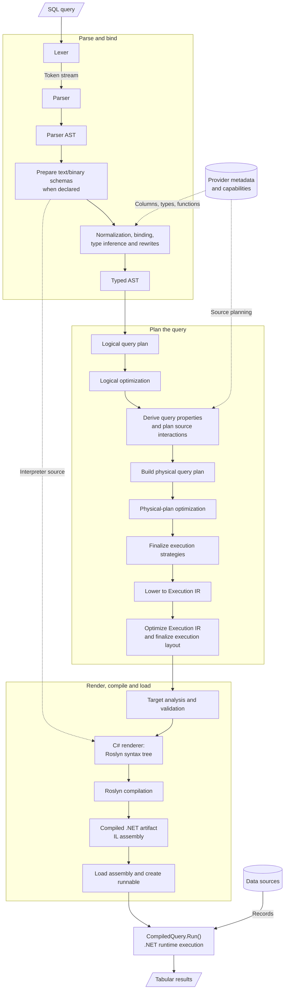

# Musoq

## Liberate SQL from the database.

SQL is too useful to be confined to a database.

**Musoq is a SQL query engine for files, logs, Git repositories, APIs, and operating-system resources.** I use it when I have a question about data and don't want to write a script just to answer it. Providers expose that data as typed rows and columns, so there is no need to import it into a database first.

You can also describe the structure of a binary file or text record. At runtime, Musoq generates the parser code that reads it, then exposes the decoded fields as columns in the same query.

I increasingly use Musoq through agents such as **Codex** and **Claude Code**, with [dedicated Musoq skills](https://github.com/Puchaczov/Musoq.Skills). I ask a question, the agent checks what data and functions are available and writes a query, and I can read, validate, and reuse the SQL. I am shaping Musoq around that way of working.

[Examples](#see-it-in-action) · [SQL features](#sql-features-at-a-glance) · [Reusable queries](#from-a-question-to-a-reusable-query) · [Experiments](#experiments-with-musoq) · [How it works](#how-a-query-runs) · [Documentation](#documentation-and-ecosystem)

[](https://opensource.org/licenses/MIT)
[](https://www.nuget.org/packages?q=musoq)


With Musoq, you can:

- **Query data where it is.** Use SQL to filter, group, and join the rows a provider reads from a source.
- **Describe how to read a format.** Declare the layout of text or binary data, let Musoq generate the parser, and query the decoded fields.
- **Join records across sources.** Match parsed log events to deployment records, or decoded packet identifiers to a device inventory.
- **Let an agent check what is available.** It can inspect sources and functions, write a query, and use the results or diagnostics to work out what to ask next.

## See it in action

The examples use Musoq's SQL dialect. The [example collection](docs/examples/readme/README.md) includes runnable queries, inputs, and expected results.

### Search several patterns, then group the matches

Search for `ERROR` and `WARN` in the same source call, then count the matches for each label with SQL.

```sql
param(root: string = './docs/examples/readme/fixtures')

select m.PatternId as Level, Count(*) as Occurrences
from search.many($root, patterns: array {
    (id: 'ERROR', pattern: 'ERROR'),
    (id: 'WARN', pattern: 'WARN')
}, options: (scope: (include: array { '*.log' }))) m
group by m.PatternId
order by Level
```

| Level | Occurrences |
|---|---:|
| ERROR | 3 |
| WARN | 1 |

Requires the **Search provider**. The example collection includes the log fixtures, execution commands, and queries that extract fields from matching lines.

For these two literal patterns, ripgrep plus PowerShell grouping produces the same totals:

```powershell
rg --no-config -o --no-filename -g '*.log' 'ERROR|WARN' ./docs/examples/readme/fixtures |
    Group-Object -NoElement |
    Sort-Object Name
```

`-o` emits each matching occurrence. `Group-Object` counts them by matched text; the SQL query groups them by pattern label. Here the labels and matched text are both `ERROR` and `WARN`.

### A decoded length determines the payload size

Read `Kind` and `Size` from the header, then use `Size` to determine how many payload bytes follow. The decoded fields become queryable columns.

```sql
binary Header {
    Kind: byte,
    Size: short le,
    Payload: byte[Size]
};

with input as (
    select FromHexToBytes('010300AABBCC') as Data
    from system.dual()
)
select
    h.Kind as Kind,
    h.Size as Size,
    Length(h.Payload) as PayloadBytes
from input i
cross apply Interpret<Header>(i.Data) h
```

**Result:** `Kind = 1`, `Size = 3`, `PayloadBytes = 3`.

Requires the **System provider**. Binary declarations also support nested records, arrays, and conditional fields.

The binary/text specification is still quite experimental. I added it because I often work with columns containing text or binary data that I need to analyze. I wanted to describe those formats once and use the description both as documentation and as a parser. The idea takes inspiration from Kaitai Struct: I declare the shape, Musoq generates the parser, and I can query the decoded fields immediately.

### Parsed text becomes queryable columns

The `Entry` declaration names the fields in each line. `Parse` exposes those fields through `APPLY`, so the query can select `Level` and `Message` and order the result by `Level`.

```sql
text Entry {
    Level: token,
    _: whitespace,
    Message: rest
};

select e.Level as Level, e.Message as Message
from values {
    (Line: 'INFO ready'),
    (Line: 'ERROR retry failed')
} s
cross apply Parse<Entry>(s.Line) e
order by Level
```

| Level | Message |
|---|---|
| ERROR | retry failed |
| INFO | ready |

This example uses inline input. Text declarations also support more complex formats and tolerant parsing.

## SQL features at a glance

The examples above only show a few parts of the language. Here is a quick overview:

| What you can do | Available syntax |
|---|---|
| Query rows | `SELECT` or `FROM`-first queries, `DISTINCT`, `WHERE`, `ORDER BY`, `NULLS FIRST`/`NULLS LAST`, `SKIP`, `TAKE`. |
| Choose output columns | `*`/`alias.*`, column-name `LIKE`/`NOT LIKE`, `EXCLUDE`, `REPLACE`, and `RENAME`. |
| Compute and match values | `CASE`, postfix `::` casts, `??` fallback, null-safe `IS DISTINCT FROM`, `LIKE`/`RLIKE`, and multi-field `any`/`all` pattern matching. |
| Group and aggregate | `GROUP BY`, `GROUP BY ALL`, positional grouping, `HAVING`, `DISTINCT` aggregates, and aggregate `FILTER`. |
| Join sources | `INNER`, `LEFT`, `RIGHT`, `FULL OUTER`, `CROSS`, `SEMI`, and `ANTI` joins; `IS PRESENT`/`IS MISSING` for unmatched sides. |
| Find nearest matches | `ASOF JOIN`, `ASOF LEFT JOIN`, and `TIE BREAK BY`. |
| Compose queries | `WITH` CTEs, `WITH RECURSIVE`, and derived tables. |
| Use subqueries | Scalar and correlated subqueries; `IN`/`NOT IN`, `EXISTS`/`NOT EXISTS`, and `ANY`/`SOME`/`ALL` comparisons. |
| Calculate over windows | Ranking, offset, aggregate, and value functions; `OVER`, `PARTITION BY`, named `WINDOW` definitions, `ROWS`/`RANGE` frames, and `QUALIFY`. |
| Combine results | `UNION`, `UNION ALL`, `INTERSECT`, and `EXCEPT`; optional comparison keys for the distinct set operations. `UNION ALL` keeps every row. |
| Expand collections | `CROSS APPLY`, `OUTER APPLY`, and `WITH ORDINALITY`. |
| Reshape data | Static `PIVOT` and `UNPIVOT`. |
| Supply reusable inputs | Inline `VALUES`, arrays, named records, typed `param`/`params` inputs, and compile-time `let` constants. |
| Declare types and sources | Query-local `ENUM`/`FLAGS ENUM` and `TABLE`/`COUPLE` source declarations. |
| Inspect available data | `DESC` for schemas, columns, arguments, and functions; `DESC QUERY` for result metadata. |
| Parse records | `binary`/`text` declarations; `Interpret`/`Parse` and tolerant `TryInterpret`/`TryParse` through `APPLY`. Still experimental. |

Musoq uses its own SQL dialect. The language specifications below describe the exact syntax and limits.

Diagnostic-aware compilation reports likely mistakes, including null-sensitive predicates such as `where Name not in ('Alice', NULL)` and impossible implicit conversions (`MQ5025`).

## From a question to a reusable query

I want to ask a question, let an agent work through the data, and keep the SQL it used to answer it. That query should be something I can read, check, and run again.

## Experiments with Musoq

One thing I enjoy about Musoq is how quickly I can try an idea. Here is one of those experiments.

### Reading SQLite data without the SQLite API

Here, an agent uses Musoq's binary format declarations and SQL to extract values from a SQLite table, directly from the file's raw bytes. It does not use the SQLite API.

[](images/experiments/sqlite-page.mp4)

Have a look at the full script in the [experiment companion](docs/examples/experiments/sqlite-page/README.md). It takes a database file and table name, finds where the data is stored, and extracts the rows.

## How a query runs

The diagram shows how Musoq generates C# from a new SQL query, compiles it into a .NET assembly, and runs it to return rows. Cached queries can reuse earlier compilation work. The engine uses provider metadata to bind and plan the query; finding a source's columns and types can itself require reading the input.



AST means abstract syntax tree; IR means intermediate representation. Roslyn emits an IL assembly, and the .NET runtime handles JIT compilation of its generated methods.

### Providers supply contracts and records

Each provider tells Musoq which source methods, columns, types, and functions it exposes. Musoq uses that information to resolve field access and function calls. The provider reads the data; Musoq applies the SQL operations to the returned records.

An agent can inspect that information before writing a query. It can check the source methods and their arguments, the returned fields, and the available functions, then write SQL using what it found.

### The engine compiles the operations

Musoq parses SQL, prepares any text or binary schemas, and resolves names and types. It builds and optimizes logical and physical plans, chooses execution strategies, then lowers the plan into Execution IR. After optimizing that IR, it generates C#. Roslyn compiles the code into a .NET assembly. Musoq loads it, creates a runnable query, and binds the source providers before execution.

The runtime handles iteration, joins, grouping, ordering, and intermediate state. This is the work I want it to take care of automatically. I can review the SQL without also having to check another set of loops and indexes written by an agent.

The compiler and runtime check the query against the language rules and provider contracts. I still need to check whether it answers the question I meant to ask.

### Parsed fields join the same query

Text and binary declarations describe how to read a record. `Parse` and `Interpret` expose its fields through `APPLY`, so the rest of the query can use them. A decoded identifier can be a join key; a parsed timestamp can be compared with deployment times; a payload field can be filtered or aggregated.

The language is designed for read-only investigation: reading source data and computing answers from it.

## Performance

Musoq already compiles generated query assemblies with Roslyn's **`OptimizationLevel.Release`**. The .NET JIT then compiles their methods to native code. Release compilation is the starting point. The plan and generated code still determine how much data is read, how much work is repeated, and how much memory is allocated.

The engine currently applies several kinds of optimization:

| Area | Current approach |
|---|---|
| Process less data | Move filters earlier where semantics allow, prune unused projections, and request supported filtering/projection from capable providers. |
| Choose suitable operators | Use hash joins for eligible equality conditions, sort-merge strategies for supported range conditions, and bounded top-N ordering for eligible `ORDER BY`/`TAKE` queries. |
| Reuse stable computations | Fold constant expressions, reuse repeated expressions, and move stable calculations out of loops where their inputs do not change. |
| Reduce intermediate allocations | Remove unused CTEs, fuse eligible single-use pipelines and read-once CTEs, and provide capacity hints for intermediate collections. |
| Use parallel execution selectively | Parallelize supported filtering, projection, aggregation, and independent CTE work when compilation options and safety checks permit it. |

These choices depend on query shape, compilation options, and source contracts.

Planning uses rules and available row-count information. It does not currently perform a global cost-based search over alternative join orders. Providers can supply useful estimates, but files, APIs, and live system resources do not necessarily expose reliable statistics or support reading the same data again.

Musoq also does not automatically cache arbitrary source or plugin calls. A changing file, a volatile field, a nondeterministic function, or a correlated source can make apparently repeated work produce different results. Moving or reusing that work must preserve the query's meaning and the source's evaluation contract.

The current execution model is primarily row-oriented and managed.

The benchmark suite measures execution, first compilation, warmed compilation, and artifact loading separately. I care about both a query I run once to answer a question and one I keep running, so compilation time matters too. I want to try an optimization, measure its time and allocations before and after, and check that the results stay correct.

## AI Usage

I started Musoq long before LLMs became everyday tools. I had questions about data, and writing Python or other scripts to answer them was tedious. I wanted to express those questions in SQL and let the runtime do the work.

**I don't like writing loops.** I want the runtime to handle iteration and bookkeeping automatically. When I am investigating data, I want to concentrate on the question and the answer.

For a long time, I struggled to give Musoq as much time as I wanted. AI has helped me focus on what the language should do and how its architecture should work, while the model handles much of the detailed implementation.

AI also makes the original idea more important to me. For these questions, I find SQL easier to validate than a generated Python script. There is less code to read, and the compiler and runtime enforce the language's rules. I can focus on whether the query asks the right question, while the engine takes care of iteration, accumulation, and matching records.

I increasingly see agents as the primary users of Musoq. I want to ask a question, have an agent read the documentation and inspect the sources, and get back a query I can understand, validate, and reuse. I want to keep using that query after the conversation ends.

Many of the questions I return to only need to read data and compute a result. They have no reason to change the underlying data. That is why Musoq's query language is read-only by design.

## Current goals

Right now, I want to get out of alpha and release a stable `17.x.y` core engine. The language already does most of what I need, so I am pausing new syntax features for a while and concentrating on stability, correctness, and thorough testing.

In my own use, the current alpha is already much more stable than the last stable release. I still want to test it more thoroughly before calling it stable.

I am also working on the benchmark infrastructure so I can measure individual language features and queries that combine them. Right now, I am focusing on:

- Measuring execution time and allocations across different query shapes and input sizes.
- Reducing allocations in the generated code and runtime.
- Avoiding unnecessary work and checking which changes produce measurable improvements.

I also want to find out how far I can get with AI-driven implementation. Tests and measurements will help me decide which changes to keep. There are lots of ideas to try, and testing them properly will take time.

At some point, I want to try native C++ alongside the managed runtime, vectorization where the row-oriented engine can benefit, and generating IL directly instead of going through C#. There will probably be other approaches I haven't thought of yet or will find in someone's article. Trying them and seeing what works is part of the fun.

Musoq already does most of what I wanted it to do. I really enjoy watching an agent read the specification and documentation, understand what is available, and produce a query I can use. Now I want to make that experience dependable and find out how much further the runtime can go.

## Documentation and ecosystem

- [Core SQL language specification](specs/musoq-core-language-spec.md) — syntax, joins, recursive CTEs, functions, and diagnostics.
- [Binary and text interpretation](specs/musoq-binary-text-spec.md) — declarative parsing inside SQL.
- [Data-source providers](https://github.com/Puchaczov/Musoq.DataSources) — the separate provider ecosystem, including Search.

## Development formatting

Restore the pinned CSharpier tool with `dotnet tool restore`, format authored C#/MSBuild files with
`dotnet csharpier format . --no-cache`, and verify with `dotnet csharpier check .`.
The shared style uses four spaces, CRLF, and a 120-column wrapping target. VS Code recommends the CSharpier
extension and enables C#/XML format-on-save; Rider users can select the same local tool integration.
CI checks formatting on Windows and Linux. Honor `.csharpierignore` so generated samples, imported fixtures,
resource designer files, benchmark history, and build outputs remain unchanged.

## License

Musoq is available under the [MIT License](LICENSE).
