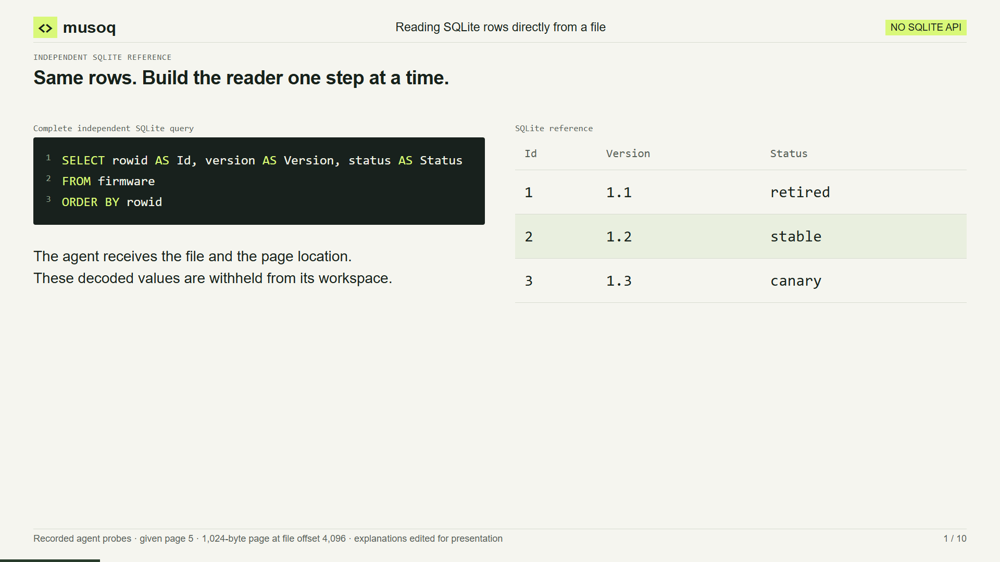
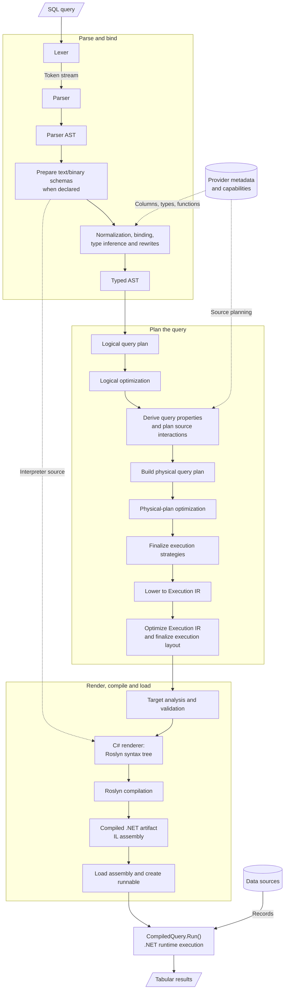

# Musoq

## Liberate SQL from the database.

SQL is too useful to be confined to a database.

**Musoq is a SQL-powered investigation runtime.** It lets agents and developers query files, logs, Git repositories, APIs, and operating-system resources without first importing everything into a database. Providers expose source data as typed rows and columns.

You describe how a binary file or text record is structured. At runtime, Musoq generates a parser from that description: the code that reads and interprets the data. The parsed values become columns you can query with SQL.

Musoq is currently being reshaped around **agent-led exploration**. Its primary workflow is through harnesses such as **Codex**, **Claude Code**, and others, using [dedicated Musoq skills](https://github.com/Puchaczov/Musoq.Skills). An agent can inspect the available sources, run a query, and use the returned rows or diagnostics to decide what to ask next. The query stays readable and reusable, so a person or another agent can inspect the method and repeat it.

[Examples](#see-it-in-action) · [Reusable queries](#from-a-question-to-a-reusable-query) · [Experiments](#experiments-with-musoq) · [How it works](#how-a-query-runs) · [Documentation](#documentation-and-ecosystem)

[](https://opensource.org/licenses/MIT)
[](https://www.nuget.org/packages?q=musoq)


Musoq separates **where data comes from** from **how you investigate it**:

- **Query sources without importing them into a database.** Providers expose source data as typed rows and columns that SQL can filter, group, and join.
- **Generate parsers from format descriptions.** Describe the layout of text or binary data and query the decoded fields with SQL.
- **Relate records across sources.** Match parsed log events to deployment records, or decoded packet identifiers to a device inventory.
- **Give agents discoverable contracts and structured results.** An agent can inspect available fields and functions, run a query, and use the returned rows or diagnostics to choose its next step.

## See it in action

The examples use Musoq's SQL dialect. The [example collection](docs/examples/readme/README.md) includes runnable queries, inputs, and expected results.

### Search several patterns, then group the matches

Search for `ERROR` and `WARN` in the same source call, then count the matches for each label with SQL.

```sql
param(root: string = './docs/examples/readme/fixtures')

select m.PatternId as Level, Count(*) as Occurrences
from search.many($root, patterns: array {
    (id: 'ERROR', pattern: 'ERROR'),
    (id: 'WARN', pattern: 'WARN')
}, options: (scope: (include: array { '*.log' }))) m
group by m.PatternId
order by Level
```

| Level | Occurrences |
|---|---:|
| ERROR | 3 |
| WARN | 1 |

Requires the **Search provider**. The example collection includes the log fixtures, execution commands, and queries that extract fields from matching lines.

For these two literal patterns, ripgrep plus PowerShell grouping produces the same totals:

```powershell
rg --no-config -o --no-filename -g '*.log' 'ERROR|WARN' ./docs/examples/readme/fixtures |
    Group-Object -NoElement |
    Sort-Object Name
```

`-o` emits each matching occurrence. `Group-Object` counts them by matched text; the SQL query groups them by pattern label. Here the labels and matched text are both `ERROR` and `WARN`.

### A decoded length determines the payload size

Read `Kind` and `Size` from the header, then use `Size` to determine how many payload bytes follow. The decoded fields become queryable columns.

```sql
binary Header {
    Kind: byte,
    Size: short le,
    Payload: byte[Size]
};

with input as (
    select FromHexToBytes('010300AABBCC') as Data
    from system.dual()
)
select
    h.Kind as Kind,
    h.Size as Size,
    Length(h.Payload) as PayloadBytes
from input i
cross apply Interpret<Header>(i.Data) h
```

**Result:** `Kind = 1`, `Size = 3`, `PayloadBytes = 3`.

Requires the **System provider**. Binary declarations also support nested records, arrays, and conditional fields.

The binary/text specification is still quite experimental. I needed something that would let me both document and query the formats I work with, especially when individual columns contain substantial text or binary payloads that I need to analyze frequently. The idea takes inspiration from Kaitai Struct, with query execution built into the workflow: I declare the shape, Musoq generates the parser, and the decoded data becomes available inside the query immediately.

### Parsed text becomes queryable columns

The `Entry` declaration names the fields in each line. `Parse` exposes those fields through `APPLY`, so the query can select `Level` and `Message` and order the result by `Level`.

```sql
text Entry {
    Level: token,
    _: whitespace,
    Message: rest
};

select e.Level as Level, e.Message as Message
from values {
    (Line: 'INFO ready'),
    (Line: 'ERROR retry failed')
} s
cross apply Parse<Entry>(s.Line) e
order by Level
```

| Level | Message |
|---|---|
| ERROR | retry failed |
| INFO | ready |

This example uses inline input. Text declarations also support more complex formats and tolerant parsing.

## From a question to a reusable query

I want to ask a question, let an agent work through the data, and keep the SQL it used to answer it. That query should be something I can read, check, and run again.

## Experiments with Musoq

Musoq lets me try ideas quickly. These experiments show where that curiosity leads.

### Reading SQLite data without the SQLite API

This experiment extracts values from a SQLite table using only Musoq queries over the database file's raw bytes. It does not use the SQLite API.

[](images/experiments/sqlite-page.mp4)

Have a look at the full script in the [experiment companion](docs/examples/experiments/sqlite-page/README.md). It takes a database file and table name, finds where the data is stored, and extracts the rows.

## How a query runs

The diagram follows the full compilation path for a new C# query artifact, then tabular execution. Provider metadata informs binding and planning; discovering a source's schema can itself require reading inputs. Cached queries can reuse earlier compilation work.



AST means abstract syntax tree; IR means intermediate representation. Roslyn emits an IL assembly, and the .NET runtime handles JIT compilation of its generated methods.

### Providers supply contracts and records

A provider exposes source methods, column names and types, and functions. The engine uses those contracts to resolve field access and function calls. Providers handle access to their sources; the engine applies SQL operations to the records they supply.

This makes a source's contract useful before an agent writes a query. It can inspect the available methods, their arguments, the returned fields, and the registered functions. It can then write SQL against that observed contract instead of guessing what a source exposes.

### The engine compiles the operations

Musoq parses SQL, prepares any text or binary schemas, binds names and types, and builds and optimizes logical and physical query plans. It finalizes execution strategies, lowers the plan into Execution IR, and optimizes that IR before rendering C#. Roslyn emits a compiled artifact; the engine loads its assembly, creates a runnable, and binds it to the source providers before execution.

Iteration, join execution, grouping, ordering, and intermediate state belong to the engine. The query author describes the result through SQL operations. An agent does not have to generate a row-processing loop, maintain its indexes, or implement its own grouping and join logic for each question.

The compiler and runtime check the query against the language's rules and source contracts. Reviewing whether the query answers the intended question remains part of the investigation.

### Parsed fields join the same query

Text and binary declarations describe how to read a record. `Parse` and `Interpret` expose its fields through `APPLY`, where they become available to the remaining SQL operations. A decoded identifier can be a join key; a parsed timestamp can be compared with deployment times; a payload field can be filtered or aggregated.

The language is designed for read-only investigation: reading source data and computing answers from it.

## Performance

Musoq compiles generated query assemblies with Roslyn's **`OptimizationLevel.Release`**. The .NET JIT then compiles their methods to native code. Release compilation is the baseline; the query plan and generated operations still determine how much data is read, how often work is repeated, and how much memory is allocated.

The engine currently applies several kinds of optimization:

| Area | Current approach |
|---|---|
| Process less data | Move filters earlier where semantics allow, prune unused projections, and request supported filtering/projection from capable providers. |
| Choose suitable operators | Use hash joins for eligible equality conditions, sort-merge strategies for supported range conditions, and bounded top-N ordering for eligible `ORDER BY`/`TAKE` queries. |
| Reuse stable computations | Fold constant expressions, reuse repeated expressions, and move stable calculations out of loops where their inputs do not change. |
| Reduce intermediate allocations | Remove unused CTEs, fuse eligible single-use pipelines and read-once CTEs, and provide capacity hints for intermediate collections. |
| Use parallel execution selectively | Parallelize supported filtering, projection, aggregation, and independent CTE work when compilation options and safety checks permit it. |

These choices depend on query shape, compilation options, and source contracts.

Planning uses rules and available row-count information. It does not currently perform a global cost-based search over alternative join orders. Providers can supply useful estimates, but files, APIs, and live system resources do not necessarily expose reliable statistics or support reading the same data again.

Musoq also does not automatically cache arbitrary source or plugin calls. A changing file, a volatile field, a nondeterministic function, or a correlated source can make apparently repeated work produce different results. Moving or reusing that work must preserve the query's meaning and the source's evaluation contract.

The current execution model is primarily row-oriented and managed.

The benchmark suite measures execution, first compilation, warmed compilation, and artifact loading separately. Compilation cost matters for a short investigation, while repeated queries can have a different cost profile. I want improvements to be supported by before/after measurements of time and allocations, with correctness checked alongside them.

## AI Usage

I started Musoq years before LLMs became part of everyday development. I had questions about data, and writing Python or other scripts to answer them was tedious. I wanted to express those questions in SQL and let a runtime do the work.

**I don't like writing loops.** I want the runtime to handle iteration and bookkeeping automatically. When I am investigating data, I want to concentrate on the question and the answer.

Giving Musoq the time I thought it deserved was difficult. AI has let me spend more of that time on what the language needs to express and on architectural decisions, while models work through the detailed implementation.

AI also makes the original idea more important to me. For these questions, I find SQL easier to validate than a generated Python script: there is less text to read, and the compiler and runtime constrain execution through the language's rules. I can review whether the query asks the right question without also reviewing a new implementation of iteration, accumulation, and record matching.

I increasingly see agents as the primary users of Musoq. I want to ask a question, have an agent read the documentation and inspect the sources, and get back a query I can understand, validate, and reuse. Making the language understandable to agents matters because that query should remain useful after the conversation ends.

Many of the questions I return to only need to read data and compute a result. They have no reason to change the underlying data. That is why Musoq's query language is read-only by design.

## Current goals

My immediate goal is to leave alpha with a stable `17.x.y` core engine. The language already covers my current needs, so I am pausing new syntax features for a while and concentrating on stability, correctness, and thorough testing.

In my own use, the current alpha is already much more stable than the last stable release. I still want broader testing and enough confidence in the existing language to make the next stable release a commitment I can stand behind.

I am also building out the benchmark infrastructure to measure individual language features and queries that combine them. My current performance work focuses on:

- Measuring execution time and allocations across different query shapes and input sizes.
- Reducing allocations in the generated code and runtime.
- Avoiding unnecessary work and checking which changes produce measurable improvements.

I want to see how far I can take AI-driven implementation, with tests and measurements guiding the changes I keep. There are plenty of ideas to try, and testing them properly will take time.

Further out, I want to experiment with native C++ alongside the managed runtime, vectorization where the row-oriented execution model can benefit, and generating IL directly instead of going through C#. Some ideas will come from articles I have not read yet or techniques I have not considered. Part of the fun is trying an approach and finding out whether it makes Musoq better.

Musoq already does most of what I wanted it to do. I really enjoy watching an agent read the specification and documentation, understand what is available, and produce a query I can use. Now I want to make that experience dependable and find out how much further the runtime can go.

## Documentation and ecosystem

- [Core SQL language specification](specs/musoq-core-language-spec.md) — syntax, joins, recursive CTEs, functions, and diagnostics.
- [Binary and text interpretation](specs/musoq-binary-text-spec.md) — declarative parsing inside SQL.
- [Data-source providers](https://github.com/Puchaczov/Musoq.DataSources) — the separate provider ecosystem, including Search.

## License

Musoq is available under the [MIT License](LICENSE).
