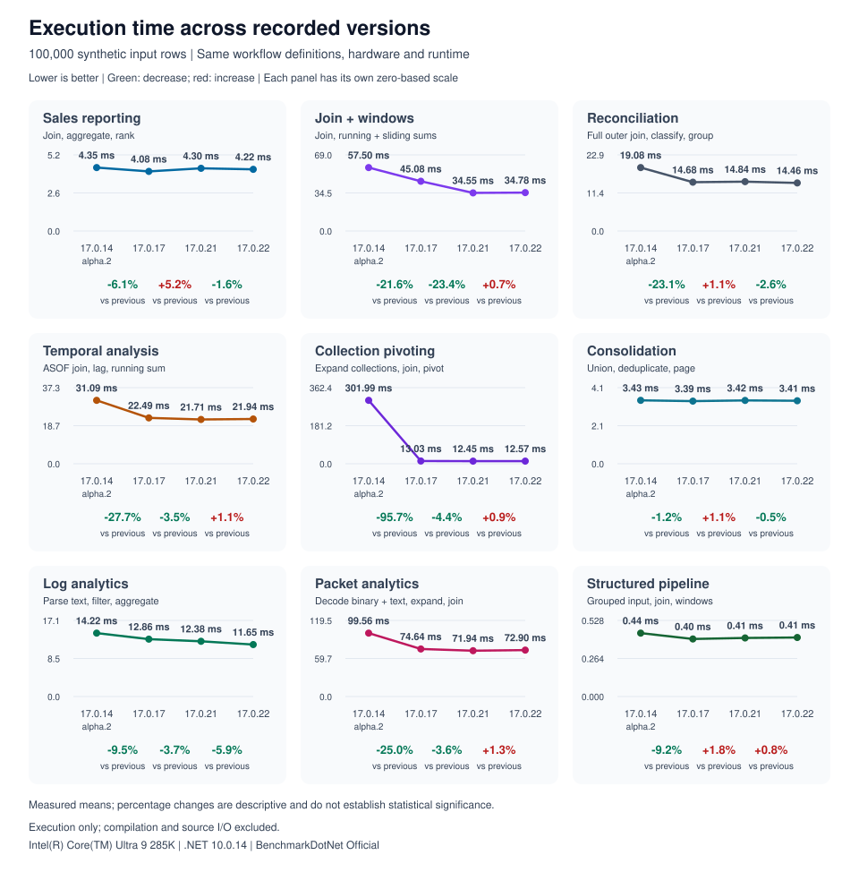
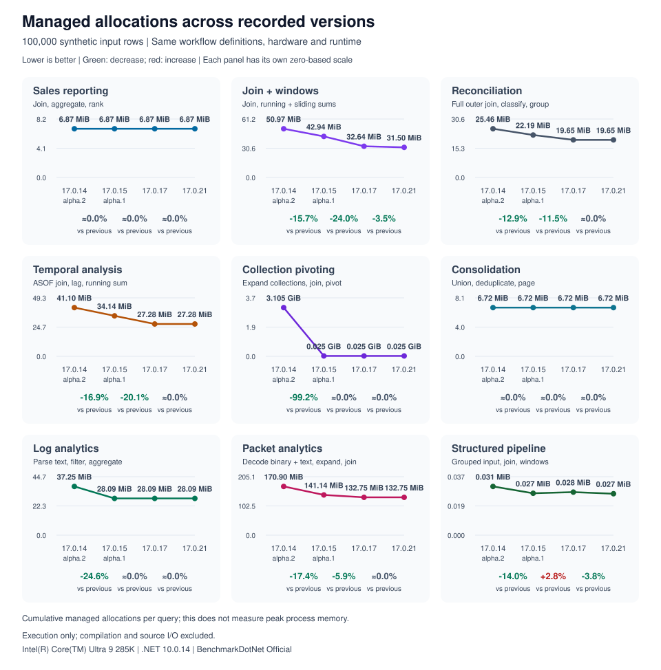
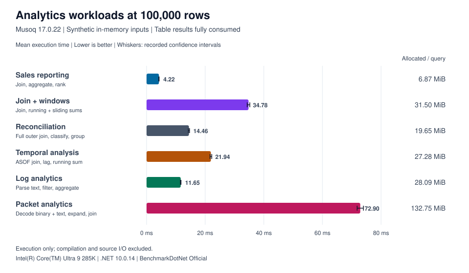
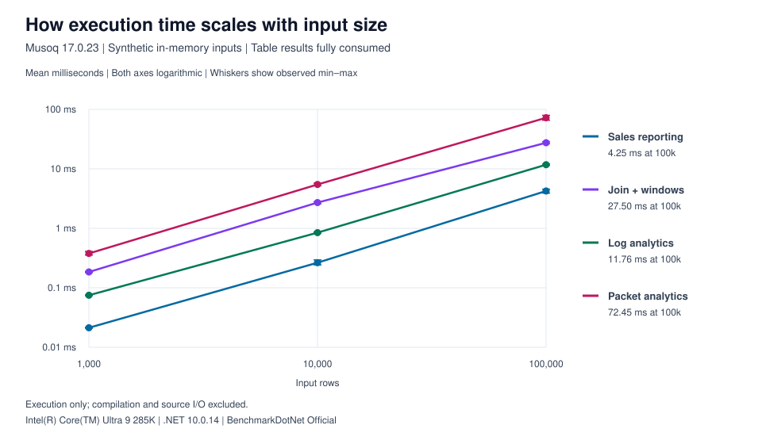
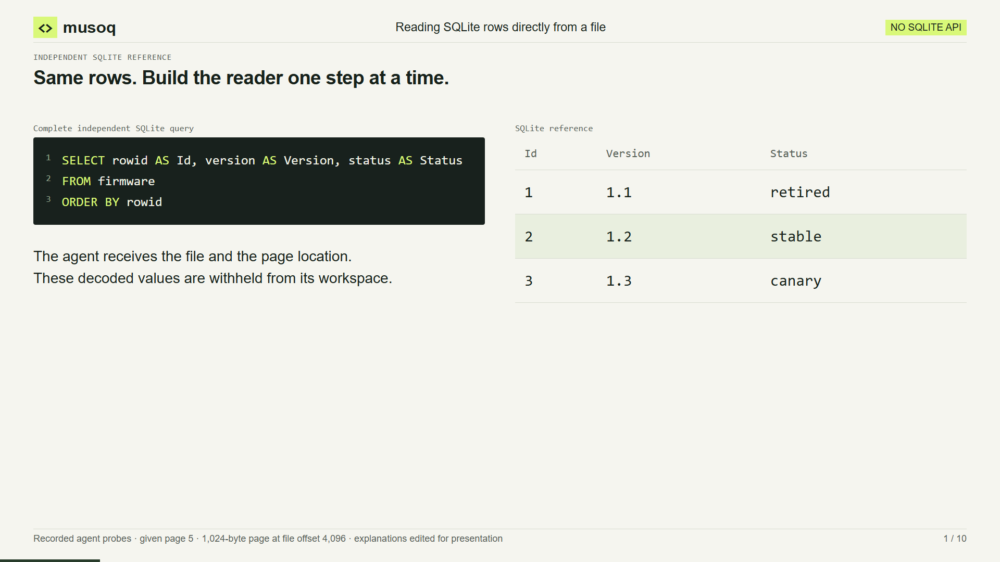
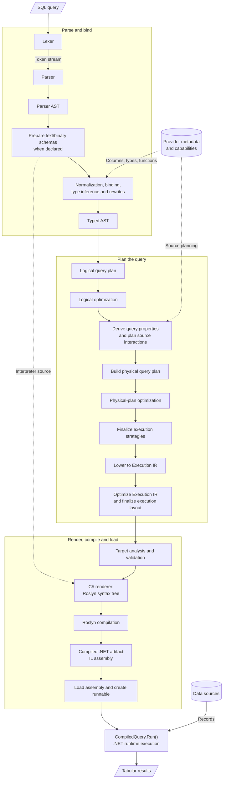

# Musoq

## Liberate SQL from database

SQL is too useful to be tied to any database.

**Musoq is a SQL query engine for files, logs, Git repositories, APIs, and operating-system resources.** I use it when I have a question about data and don't want to write a script just to answer it. Providers expose that data as typed rows and columns, so there is no need to import it into a database first.

Musoq extends SQL with declarative text and binary layouts, generating parsers as part of query compilation so you can describe a format and query its contents in the same script.

I increasingly use the engine through coding agents. I ask a question, the agent writes a query, I can read it, validate, and reuse. I am shaping Musoq around that way of working.

[SQL investigations](#keep-the-investigation-in-sql) · [Format discovery](#discover-a-format-then-query-the-files) · [Dogfooding](#using-musoq-to-develop-musoq) · [SQL features](#sql-features-at-a-glance) · [Reusable queries](#from-a-question-to-a-reusable-query) · [Experiments](#experiments-with-musoq) · [How it works](#how-a-query-runs)

[](https://opensource.org/licenses/MIT)
[](https://www.nuget.org/packages?q=musoq)


With Musoq, you can:

- **Query data where it lives.** Read files, logs, repositories, APIs, and system resources as rows and columns.
- **Search and investigate.** Find patterns, extract fields, and retain source paths and line numbers alongside your findings.
- **Describe unfamiliar formats.** Declare a text or binary layout, let Musoq generate the parser, and query the decoded fields.
- **Connect different sources.** Join parsed logs to deployment records, compare inventories, or find records missing from another dataset.
- **Ask more involved questions.** Calculate running totals, correlate events over time, rank results, and traverse hierarchical relationships using SQL.
- **Keep the investigation reusable.** Saved parameterized SQL that agent can inspect, refine, and run against new inputs.

## Keep the investigation in SQL

Many repository and log investigations start with a text search. Musoq's Search provider covers common ripgrep-style tasks: finding matching files and lines, searching several patterns, extracting fields, and counting matches. I can then keep those findings in SQL to compare sets of files, group the results, or join them with other data.

### Search several patterns, then group the matches

Search for `ERROR` and `WARN` in the same source call, then count the matches for each label with SQL.

```sql
param(root: string = './docs/examples/readme/fixtures')

select m.PatternId as Level, Count(*) as Occurrences
from search.many($root, patterns: array {
    (id: 'ERROR', pattern: 'ERROR'),
    (id: 'WARN', pattern: 'WARN')
}, options: (scope: (include: array { '*.log' }))) m
group by m.PatternId
order by Level
```

| Level | Occurrences |
|---|---:|
| ERROR | 3 |
| WARN | 1 |

The synthetic log fixtures are in `docs/examples/readme/fixtures`.

For these two literal patterns, ripgrep plus PowerShell grouping produces the same totals:

```powershell
rg --no-config -o --no-filename -g '*.log' 'ERROR|WARN' ./docs/examples/readme/fixtures |
    Group-Object -NoElement |
    Sort-Object Name
```

## Discover a format, then query the files

Like [Kaitai Struct](https://kaitai.io/), Musoq lets me describe a binary layout declaratively: fields, lengths, byte order, nested records, and conditional structures. The declaration lives alongside the SQL. Musoq generates and compiles the parser on the fly when it compiles the query, then exposes the decoded fields as columns.

An agent can start with the part of a format it understands, query sample files, inspect the results, and extend the declaration as it discovers more of the layout. The same declaration can then be applied to every file supplied by a provider, so one query can compare, filter, or aggregate decoded values across a whole collection of files.

The declaration also serves as executable documentation of the format. It records my understanding of the layout and tells Musoq how to read it. As that understanding improves, I can refine the declaration and immediately query the decoded fields across the file collection. The format description and the analysis stay together in the same SQL file.

The binary/text specification is still quite experimental. I added it for investigations where understanding the format and analyzing its contents happen together.

### Find oversized PNG images

Which image assets exceed 2,048 pixels in either dimension? Describe the PNG header, then query every PNG in a directory and its subdirectories.

```sql
param(root: string = './images')

binary PngHeader {
    SignatureStart: ushort be,
    SignatureEnd: ushort be,
    SignatureLow: uint be,
    HeaderLength: uint be,
    HeaderType: uint be,
    Width: uint be,
    Height: uint be
};

select f.FullPath as Path, p.Width as Width, p.Height as Height
from os.files($root, true) f
cross apply TryInterpret<PngHeader>(f.GetFileBytes(24, 0)) p
where ToLowerInvariant(f.Extension) = '.png'
  and p.SignatureStart = 0x8950 and p.SignatureEnd = 0x4E47 and p.SignatureLow = 0x0D0A1A0A
  and p.HeaderLength = 13 and p.HeaderType = 0x49484452
  and (p.Width > 2048 or p.Height > 2048)
order by Path
```

### Find x86 DLLs in an x64 release

Did a 32-bit native DLL slip into an x64 package? Read the DOS header's offset to the PE header, then filter DLLs by their machine type.

```sql
param(root: string = './release')

binary PeHeader {
    DosSignature: ushort le,
    PeOffset: uint le at 0x3C,
    Signature: uint le at PeOffset,
    Machine: ushort le
};

select f.FullPath as Path, 'x86' as Architecture
from os.files($root, true) f
cross apply TryInterpret<PeHeader>(f.GetFileBytes(f.Length, 0)) p
where ToLowerInvariant(f.Extension) = '.dll'
  and p.DosSignature = 0x5A4D and p.Signature = 0x00004550
  and p.Machine = 0x014C
order by Path
```

### Inspect a ZIP without extracting it

What is inside a release archive? Query the ZIP's file size and modification time alongside each file's full entry name, original and compressed sizes, and timestamp.

```sql
param(archive: string = './release.zip')

select
    f.FullPath as Archive,
    f.Length as ArchiveBytes,
    f.LastWriteTime as ArchiveModified,
    e.FullName as Entry,
    e.Length as Bytes,
    e.CompressedLength as CompressedBytes,
    e.LastWriteTime as EntryModified
from os.file($archive) f
cross join os.zip($archive) e
order by Entry
```

## Performance

Performance has become one of my main priorities for Musoq. I use it to process growing amounts of data in more formats, and some workloads span dozens of gigabytes. Agents can issue several queries as they investigate a question, so I need the engine to stay fast as that work adds up.

At that scale, bottlenecks in earlier versions became serious limits on what I could do. That is why I started to track execution time and allocations across versions, and this is why I care about how much work a query repeats and how much intermediate data it creates.

### Benchmark trends

The charts below follow nine composed synthetic workflows over **100,000 input rows**, using the recorded **17.0.14-alpha.2**, **17.0.15-alpha.1**, and **17.0.17** Official campaigns. All three used the same Intel Core Ultra 9 285K, .NET 10.0.14, and benchmark settings.





Queries are compiled before measurement; inputs are synthetic and in memory, and all result rows are consumed. Source I/O and compilation are excluded. Allocations are cumulative managed bytes per query, rather than peak process memory. Results depend on the query, provider, data distribution, and hardware.

<details>
<summary>17.0.17 workload timings and input-size scaling</summary>





</details>

### How the engine reduces work

Musoq already compiles generated query assemblies with Roslyn's **`OptimizationLevel.Release`**. The .NET JIT then compiles their methods to native code. Release compilation is the starting point. The plan and generated code still determine how much data is read, how much work is repeated, and how much memory is allocated.

The engine currently applies several kinds of optimization:

| Area | Current approach |
|---|---|
| Process less data | Move filters earlier where semantics allow, prune unused projections, and request supported filtering/projection from capable providers. |
| Choose suitable operators | Use hash joins for eligible equality conditions and sort-merge strategies for supported range conditions; choose a smaller hash-build input when row-count information supports it. Specialize aggregation by grouping-key shape, stream eligible `UNION ALL` inputs, use hash-based set operations, and bound ordering for eligible `ORDER BY` with `TAKE` or `SKIP`/`TAKE`. |
| Match text efficiently | Turn eligible `LIKE` and simple `RLIKE` patterns into direct string comparisons; prepare and reuse matchers for other supported patterns. |
| Share window work | Share partition and ordering-key preparation between compatible windows, and use specialized running or batch evaluation for supported functions and frames. |
| Reuse stable computations | Fold constant expressions, reuse repeated expressions, and move stable calculations out of loops where their inputs do not change. |
| Reduce intermediate allocations | Remove unused CTEs, fuse eligible single-use pipelines and read-once CTEs, use compact typed source rows where supported, and provide capacity hints for intermediate collections. Build reusable CTE lookup indexes while producing rows and reuse iteration-independent inputs in eligible recursive queries. |
| Reduce byte-buffer copying | Plan byte ranges, lengths, and bounded prefixes to avoid unnecessary byte-array copies while preserving required snapshot behavior. |
| Use parallel execution selectively | Parallelize supported filtering, projection, aggregation, and independent CTE work when compilation options and safety checks permit it. |
| Reuse compilation work | Reuse parsed query templates, semantic analysis, and compiled artifacts for compatible requests, reducing work before execution. |

These choices depend on query shape, compilation options, and source contracts.

Planning uses rules and available row-count information. It does not currently perform a global cost-based search over alternative join orders. Providers can supply useful estimates, but files, APIs, and live system resources do not necessarily expose reliable statistics or support reading the same data again.

Musoq also does not automatically cache arbitrary source or plugin calls. A changing file, a volatile field, a nondeterministic function, or a correlated source can make apparently repeated work produce different results. Moving or reusing that work must preserve the query's meaning and the source's evaluation contract.

The current execution model is primarily row-oriented and managed.

The benchmark suite measures execution, first compilation, warmed compilation, and artifact loading separately. I care about both a query I run once to answer a question and one I keep running, so compilation time matters too. I want to try an optimization, measure its time and allocations before and after, and check that the results stay correct.

## SQL features at a glance

The examples above only show a few parts of the language. Here is a quick overview:

| What you can do | Available syntax |
|---|---|
| Query rows | `SELECT` or `FROM`-first queries, `DISTINCT`, `WHERE`, `ORDER BY`, `NULLS FIRST`/`NULLS LAST`, `SKIP`, `TAKE`. |
| Choose output columns | `*`/`alias.*`, column-name `LIKE`/`NOT LIKE`, `EXCLUDE`, `REPLACE`, and `RENAME`. |
| Compute and match values | `CASE`, postfix `::` casts, `??` fallback, null-safe `IS DISTINCT FROM`, `LIKE`/`RLIKE`, and multi-field `any`/`all` pattern matching. |
| Group and aggregate | `GROUP BY`, `GROUP BY ALL`, positional grouping, `HAVING`, `DISTINCT` aggregates, and aggregate `FILTER`. |
| Join sources | `INNER`, `LEFT`, `RIGHT`, `FULL OUTER`, `CROSS`, `SEMI`, and `ANTI` joins; `IS PRESENT`/`IS MISSING` for unmatched sides. |
| Find nearest matches | `ASOF JOIN`, `ASOF LEFT JOIN`, and `TIE BREAK BY`. |
| Compose queries | `WITH` CTEs, `WITH RECURSIVE`, and derived tables. |
| Use subqueries | Scalar and correlated subqueries; `IN`/`NOT IN`, `EXISTS`/`NOT EXISTS`, and `ANY`/`SOME`/`ALL` comparisons. |
| Calculate over windows | Ranking, offset, aggregate, and value functions; `OVER`, `PARTITION BY`, named `WINDOW` definitions, `ROWS`/`RANGE` frames, and `QUALIFY`. |
| Combine results | `UNION`, `UNION ALL`, `INTERSECT`, and `EXCEPT`; optional comparison keys for the distinct set operations. `UNION ALL` keeps every row. |
| Expand collections | `CROSS APPLY`, `OUTER APPLY`, and `WITH ORDINALITY`. |
| Reshape data | Static `PIVOT` and `UNPIVOT`. |
| Supply reusable inputs | Inline `VALUES`, arrays, named records, typed `param`/`params` inputs, and compile-time `let` constants. |
| Declare types and sources | Query-local `ENUM`/`FLAGS ENUM` and `TABLE`/`COUPLE` source declarations. |
| Inspect available data | `DESC` for schemas, columns, arguments, and functions; `DESC QUERY` for result metadata. |
| Parse records | `binary`/`text` declarations; `Interpret`/`Parse` and tolerant `TryInterpret`/`TryParse` through `APPLY`. Still experimental. |

Musoq uses its own SQL dialect.

Diagnostic-aware compilation reports likely mistakes, including null-sensitive predicates such as `where Name not in ('Alice', NULL)` and impossible implicit conversions (`MQ5025`).

## From a question to a reusable query

I want to ask a question, let an agent work through the data, and keep the SQL it used to answer it. That query should be something I can read, check, and run again.

## Experiments with Musoq

One thing I enjoy about Musoq is how quickly I can try an idea. These experiments show what an agent can build with SQL and declarative format descriptions.

### Query a SQLite table from the raw database file

Point the [standalone SQL script](docs/examples/experiments/sqlite-page/read-sqlite-table.sql) at a database file and give it a table name. Musoq reads the original bytes, decodes the database header and catalog, finds the table's root page, and follows its page tree to extract all stored rows from a supported rowid table. The decoding uses Musoq's binary declarations and SQL, without a SQLite API or SQLite datasource.

The script accepts `databasePath` and `tableName` as typed query parameters. Supply them through the engine's `CompiledQuery.TypedParameters` API in a host with a filesystem datasource. The bundled input is `docs/examples/experiments/sqlite-page/inputs/telemetry.db`, with table `events`.

Change `databasePath` and `tableName` to choose another database and table. The bundled example decodes all **480 rows** of `events` across ten leaf pages. Each result includes the table name, row ID, stored field values as JSON, and page/cell coordinates.

This experimental reader supports ordinary rowid tables whose record payloads fit on their leaf pages. Use a small, consistent, checkpointed main-database file; the reader loads its pages into memory. Its output represents stored records rather than SQLite's full `SELECT *` semantics: it does not reconstruct column names, schema defaults, generated columns, or affinity conversions. Overflow payloads, WAL/journal replay, virtual tables, and `WITHOUT ROWID` tables are outside its scope. Recursive CTE limits still apply to deep trees and very wide records.

[](images/experiments/sqlite-page.mp4)

The movie shows how the smaller page reader was built. The standalone script above extends that approach to a parameterized table reader.

## How a query runs

The diagram shows how Musoq generates C# from a new SQL query, compiles it into a .NET assembly, and runs it to return rows. Cached queries can reuse earlier compilation work. The engine uses provider metadata to bind and plan the query; finding a source's columns and types can itself require reading the input.



### Providers supply contracts and records

Each provider tells Musoq which source methods, columns, types, and functions it exposes. Musoq uses that information to resolve field access and function calls. The provider reads the data; Musoq applies the SQL operations to the returned records.

An agent can inspect that information before writing a query. It can check the source methods and their arguments, the returned fields, and the available functions, then write SQL using what it found.

## AI Usage

I started Musoq long before LLMs became everyday tools. I had questions about data, and writing Python or other scripts to answer them was tedious. I wanted to express those questions in SQL and let the runtime do the work.

I don't like writing loops. I want the runtime to handle iteration and bookkeeping automatically. When I am investigating data, I want to concentrate on the question and the answer.

For a long time, I struggled to give Musoq as much time as I wanted. AI has helped me focus on what the language should do and how its architecture should work, while the model handles much of the detailed implementation.

AI also makes the original idea more important to me. For these questions, I find SQL easier to validate than a generated Python script. There is less code to read, and the compiler and runtime enforce the language's rules. I can focus on whether the query asks the right question, while the engine takes care of iteration, accumulation, and matching records.

I increasingly see agents as the primary users of Musoq. I want to ask a question, have an agent read the documentation and inspect the sources, and get back a query I can understand, validate, and reuse. I want to keep using that query after the conversation ends.

Many of the questions I return to only need to read data and compute a result. They have no reason to change the underlying data. That is why Musoq's query language is read-only by design.

## Current goals

The language already does most of what I need, so I am pausing new syntax features for a while and concentrating on stability, correctness, and thorough testing.

In my own use, the engine is stable and agents can use it effectively. It doesn't mean it doesn't have bugs - it does and I am clashing them once they are found. I still need to test it more thoroughly and looking for a way to create a more robust testing framework.

Benchmark infrastructure right now gained a lot of importance. I'm trying to measure the impact of changes and lead the development across performance metrics. Key goals for near future are:

- Reduce allocations in the generated code and runtime.
- Avoid unnecessary work.
- Keep the engine saturated with CPU and memory bandwidth.

I also want to find out how far I can get with AI-driven implementation. Extensive tests and measurements lead me to decide which changes to keep. There are lots of ideas to try, and testing them properly will take time.

At some point, I want to try native C++ alongside the managed runtime, vectorization where the row-oriented engine can benefit, and generating IL directly instead of going through C#. There will probably be other approaches I haven't thought of yet or will find in someone's article. Trying them and seeing what works is part of the fun.

I really enjoy watching an agent read the specification and documentation of the current version, understand what is available, produce a query and iterate on it.

## License

Musoq is available under the [MIT License](LICENSE).
